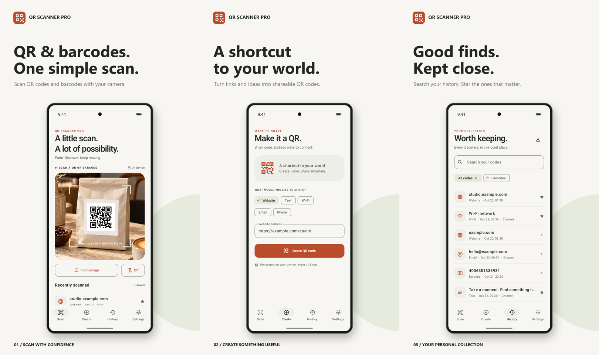

# QR Scanner Pro

A native Kotlin + Jetpack Compose QR and barcode scanner for Android, built for a paid, ad-free Play Store release.



- **Package:** `com.deploydulupulangnanti.qrcodescanner`
- **Developer:** PT Deploy Dulu Pulang Nanti
- **Support:** seandyadryan2@gmail.com

## The app

- CameraX live scanning, tap to focus, flashlight, zoom, and selected-image scanning. It prefers the rear camera and falls back to another available camera on devices such as Chromebooks.
- Offline ZXing decoding: QR, EAN/UPC, Code 128/39/93, Codabar, ITF, Data Matrix, Aztec, PDF417.
- QR creation for websites, text, Wi-Fi, email, and phone numbers.
- Local history (1,000 records), favorites, search, individual deletion, clear-all confirmation, and CSV export with formula escaping.
- QR PNG export and sharing through Android’s document picker and share sheet.
- Deliberate link opening: scan content is displayed before an external app is launched.
- Light/dark appearance, scalable Compose layouts, and navigation rail on large screens.
- No ads, analytics, accounts, subscriptions, internet permission, or cloud backup.

This app decodes barcode content; it does not have a product-price database, malware detection, or automatic Wi-Fi joining. The paid app price is set in Play Console.

## Development

Open this folder in Android Studio. Install SDK 36 and use Java 17 or newer. Minimum supported Android is 8.0 (API 26). The project includes a Gradle 8.14 wrapper.

```sh
./gradlew testDebugUnitTest lintRelease assembleDebug
```

Release signing reads `KEYSTORE_PATH`, `KEYSTORE_PASSWORD`, `KEY_ALIAS`, and `KEY_PASSWORD` from the environment or the ignored `keystore.properties`. Do not commit credentials or signing keys.

```sh
./gradlew assembleRelease bundleRelease
```

## Store package

- [English listing](store/listing/en-US)
- [App icon and feature graphic](store/graphics)
- [Phone, tablet and desktop artwork](store/screenshots)
- [Promo MP4 and storyboard](store/video)
- [Privacy policy](index.html)
- [Artwork specifications and provenance](store/ASSETS.md)
- [Release and Play Console handoff](docs/RELEASE.md)

The screenshot generator uses actual captured Android UI and complete device frames. Demo imagery and records are confined to debug captures; release builds do not contain the staged camera asset. Capture scripts are in `tools/`. To regenerate artwork, install `tools/requirements.txt`, run `prepare_demo.py`, build/install the debug app, capture with `capture_android.py`, then run `make_store_assets.py --video`.

## CI

`.github/workflows/android-release.yml` uses a GitHub-hosted Ubuntu runner. It runs on **manual dispatch or `v*` tags only** to avoid consuming runner minutes on everyday pushes. It tests, lints, builds signed APK/AAB, and retains build artifacts for 14 days. It never publishes to Play Console automatically.

Manual runs can also publish only the privacy policy to GitHub Pages. Tag runs skip that job, and ordinary pushes do not trigger Pages publishing. The privacy page is intended for `https://seandyadryan.github.io/qr-code-scanner/`.

Original application code and artwork © 2026 PT Deploy Dulu Pulang Nanti. Third-party components retain their respective Apache 2.0 licenses; see `NOTICE.txt` and the in-app open source notices.
